<!-- Encabezado animado: se adapta al tema claro u oscuro de GitHub -->
<a href="https://ferandsolutions1406.github.io/portafolio/">
<picture>
  <source media="(prefers-color-scheme: dark)" srcset="assets/header-dark.svg">
  
</picture>
</a>

  
  
  
  
  

## 👋 Hola, soy Iván

Desarrollador de software **full stack** especializado en **PHP y Laravel**. Analizo antes de implementar: construyo sistemas **robustos, mantenibles y seguros** y los llevo desde el requerimiento hasta el servidor. Hoy esos sistemas atienden la nube documental de una empresa de logística, el tránsito aduanero internacional, el control de ingreso de un contact center, las peticiones ciudadanas de entidades públicas y el portal de un organismo de tránsito.

<table>
<tr>
<td>🧱 <b>Arquitectura</b> MVC, servicios y colas · multiempresa con roles y auditoría</td>
<td>⚡ <b>Tiempo real</b> WebSockets con Reverb · apps de escritorio en Flutter</td>
<td>🚀 <b>DevOps</b> Docker · Traefik · Nginx · VPS Linux · respaldos</td>
<td>🛡️ <b>Seguridad</b> OWASP · rate limiting · URLs firmadas · SHA-256</td>
</tr>
</table>

## 🚀 Proyectos destacados

Capturas reales tomadas sobre bases de datos de prueba. Toca cualquiera para ver todas las pantallas y su <b>demo interactiva</b> en el <a href="https://ferandsolutions1406.github.io/portafolio/">portafolio</a>.

<table>
<tr>
<td width="50%" valign="top">

<h3>☁️ Nexus Cloud · Cloud SLC</h3>

Nube documental multiempresa con app de escritorio para Windows y macOS que avisa en tiempo real quién tiene abierto cada archivo.

<code>Laravel 13</code> <code>Reverb</code> <code>Flutter</code> <code>Docker</code>

</td>
<td width="50%" valign="top">

<h3>🚛 Sistema Aduanero</h3>

Tránsito aduanero internacional: operaciones con CPIC, MCI y DTAI, validación con consecutivos oficiales y documentos en PDF.

<code>Laravel 12</code> <code>Bootstrap 5</code> <code>Turbo</code> <code>PDF</code>

</td>
</tr><tr>
<td width="50%" valign="top">

<h3>⏱️ Nexus Control de Ingreso</h3>

Estados de agentes en vivo, malla horaria, horas extra preautorizadas y reportes de adherencia para un contact center.

<code>Laravel</code> <code>Reverb</code> <code>Sanctum</code> <code>Excel</code>

</td>
<td width="50%" valign="top">

<h3>📨 NexusTrack PQRSD</h3>

Peticiones, quejas y reclamos con portal ciudadano, plazos de ley en días hábiles y gestión documental.

<code>Laravel 12</code> <code>Spatie</code> <code>Twilio</code> <code>DomPDF</code>

</td>
</tr><tr>
<td width="50%" valign="top">

<h3>📊 Nexus Métricas</h3>

Inteligencia de negocio para contact center: gerencia, comercial con pipeline Kanban, experiencia e infraestructura.

<code>Laravel</code> <code>Livewire</code> <code>ApexCharts</code> <code>Power BI</code>

</td>
<td width="50%" valign="top">

<h3>📱 Nexus Finance</h3>

Venta de celulares a crédito: plan de cuotas, mora y bloqueo remoto del equipo Android con códigos de desbloqueo.

<code>Laravel</code> <code>Firebase FCM</code> <code>Android</code> <code>Chart.js</code>

</td>
</tr><tr>
<td width="50%" valign="top">

<h3>💌 Nexus Eventia</h3>

Invitaciones digitales con 20 diseños, confirmación de asistencia, cupos, QR y panel de estadísticas.

<code>Laravel</code> <code>Tailwind v4</code> <code>QR</code> <code>PDF</code>

</td>
<td width="50%" valign="top">

<h3>🗂️ Nexus Archivo</h3>

Expediente digital por placa con huella SHA-256 y auditoría encadenada que detecta cualquier alteración.

<code>Laravel 13</code> <code>SHA-256</code> <code>S3</code> <code>Power BI</code>

</td>
</tr>
</table>

<a href="https://ferandsolutions1406.github.io/portafolio/#proyectos"><b>Ver los 14 sistemas con sus demos interactivas →</b></a>

## 🛠️ Stack

  <a href="https://skillicons.dev"><picture>
    <source media="(prefers-color-scheme: dark)" srcset="https://skillicons.dev/icons?i=php%2Claravel%2Cmysql%2Cjs%2Chtml%2Ccss%2Ctailwind%2Cbootstrap%2Cflutter%2Cdart%2Cdotnet%2Ccs%2Cpython%2Cdocker%2Cnginx%2Clinux%2Cgit%2Cgithub%2Caws%2Cvue%2Creact%2Cpostman&perline=11&theme=dark">
    
  </picture></a>

  
  
  
  
  
  
  
  
  

## 📈 Actividad

<picture>
  <source media="(prefers-color-scheme: dark)" srcset="assets/activity-dark.svg">
  
</picture>

## 🧭 Trayectoria

| Periodo | Rol | Empresa |
|---|---|---|
| 2025 – hoy | **Desarrollador Full Stack** · independiente | Proyectos de software a la medida |
| 2026 – hoy | **Desarrollador Full Stack** · freelance | SLC · Soluciones y Logísticas Confiables |
| 2 años | **Desarrollador Web** · remoto | GETS · Grupo Empresarial Tecnológico Simbiótica |
| 3 años | **Desarrollador Web** · remoto | Neuro Sabanas SAS |
| 1 año | **Desarrollador de Software** (.NET / C#) | Zeus Tecnología S.A. |
| 2,5 años | **Coordinador de Sistemas** | Namaste Beach Club |
| 1 año | **Técnico de Sistemas** | IPS Delta Cartagena |
| 8 meses | **Técnico de Redes** | Grupo Heroica |

🎓 **Ingeniería de Sistemas** (UNAD, en curso) · **Tecnólogo en Análisis y Desarrollo de Sistemas de Información** (SENA)

## 📫 Hablemos

  

<picture>
  <source media="(prefers-color-scheme: dark)" srcset="assets/footer-dark.svg">
  
</picture>
